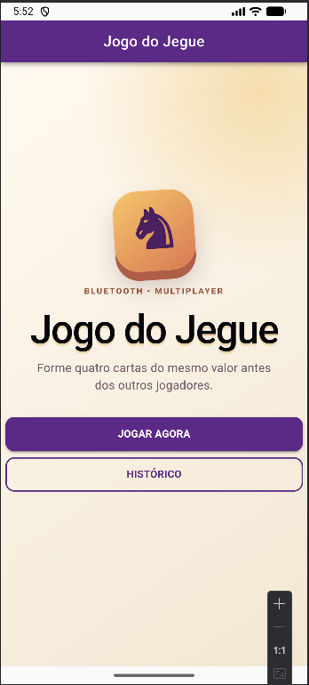
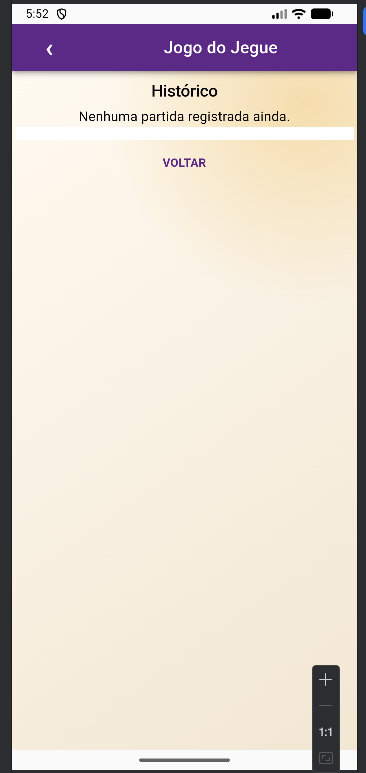
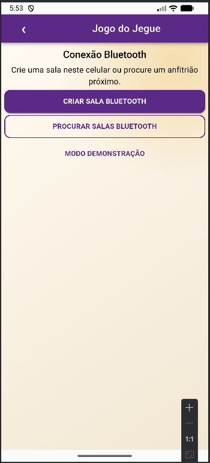
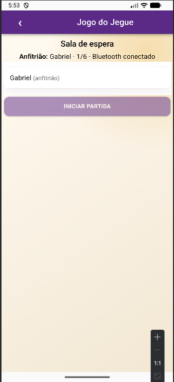
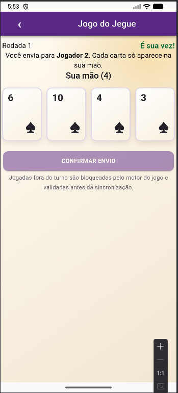

# Jogo Burro via Bluetooth

Atividade avaliativa multidisciplinar — Etapa 01.

## Entrega

- **Curso:** Informatica.
- **UCs:** Codificar acesso a web services e recursos de sistemas móveis; Codificar aplicações para dispositivos móveis.
- **Integrantes:** Gustavo Pereira.

## Regras e arquitetura

Cada jogador recebe quatro cartas e, no seu turno, envia uma ao próximo jogador na ordem da sala. Quem forma quatro cartas do mesmo valor vence. O destinatário da jogada vencedora é identificado como penalizado nesta versão. O motor bloqueia cartas inválidas, partidas encerradas e jogadas fora do turno.

`src/game.ts` isola regras; `src/bluetooth.ts` inicializa BLE e valida mensagens; `src/storage.ts` mantém o histórico local com Capacitor Preferences.

```text
Cliente -- SOLICITACAO_ENTRADA --> Anfitrião
Anfitrião -- PARTIDA_INICIADA --> participantes
Jogador -- JOGADA --> anfitrião (valida turno/carta)
Anfitrião -- TROCA_REALIZADA/PARTIDA_FINALIZADA --> participantes
```

Mensagem: `{ "type":"JOGADA", "matchId":"uuid", "playerId":"uuid", "payload":{"cardId":"uuid"}, "sentAt":"ISO-8601" }`.

## Executar

```bash
npm install
npm run build
npx cap add android
npx cap sync android
npx cap open android
```

Use dois celulares Android físicos e aceite permissões de Bluetooth. No navegador, `npm run dev` permite testar a interface usando **Aceitar jogador (demo)**.

Android 12+ requer `BLUETOOTH_SCAN`, `BLUETOOTH_CONNECT` e, ao anunciar, `BLUETOOTH_ADVERTISE`; versões anteriores podem pedir `ACCESS_FINE_LOCATION`. iOS requer `NSBluetoothAlwaysUsageDescription`.

## Checklist

- [x] Vue, Ionic, Capacitor, telas, regras, validação e persistência de histórico.
- [x] Detalhes, exclusão com confirmação e documentação de mensagens/permissões.
- [ ] Transporte P2P BLE: o plugin instalado é cliente BLE; para o anfitrião anunciar a sala em outro celular, inclua um peripheral/GATT server Android e ligue-o ao contrato de mensagens.
- [ ] Reconexão automática, pontuação acumulada BURRO, prints/GIF e vídeo de demonstração.










